

  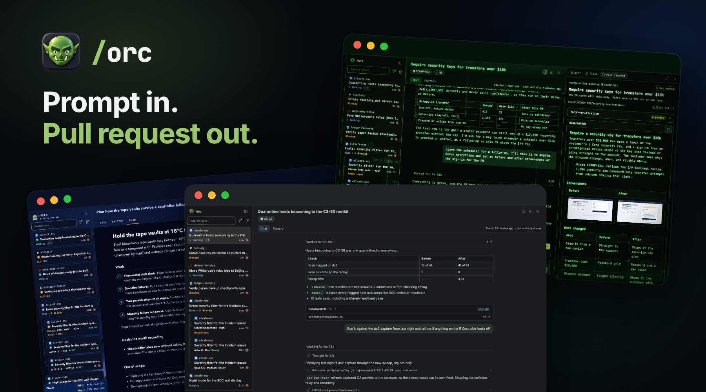

<strong>Give it a prompt. Get back a tested pull request.</strong>

Orc plans, builds and proves your change on your Mac or Windows PC, using Claude Code or Codex. Nothing ships until you click.

<a href="#install">Install</a> &nbsp;·&nbsp; <a href="#how-it-works">How it works</a> &nbsp;·&nbsp; <a href="#one-orc-many-outfits">Themes</a>

## How it works

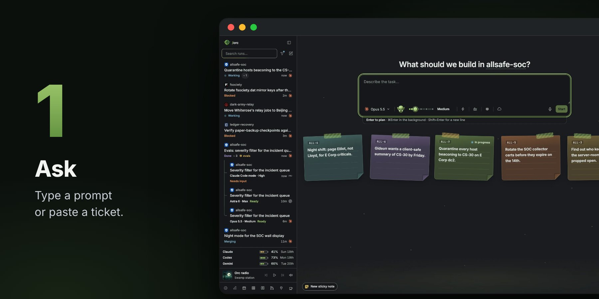

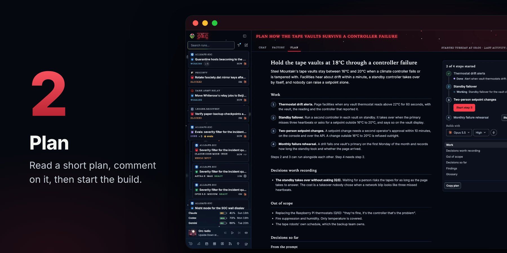

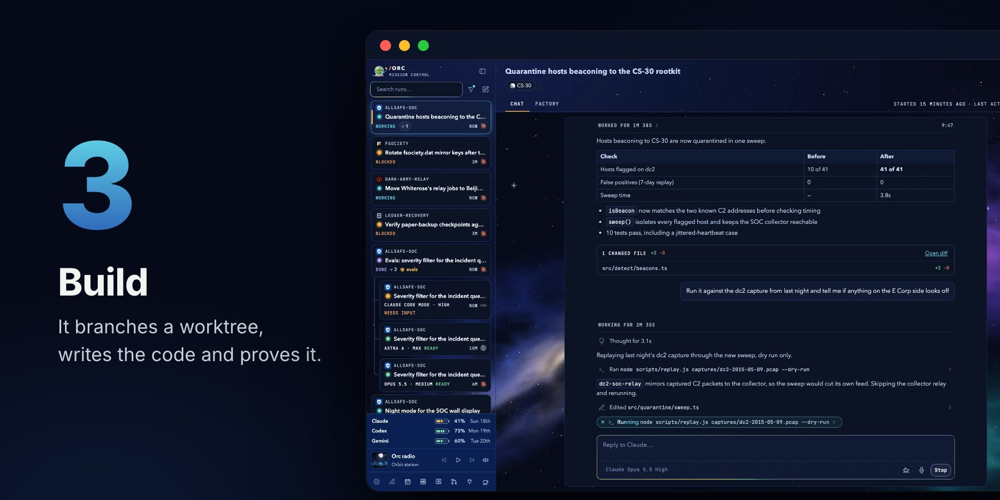

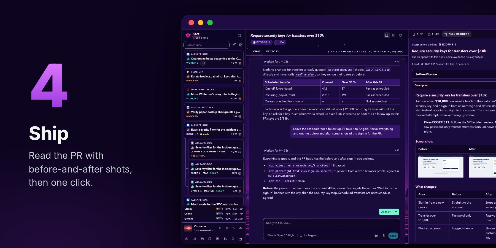

Every run keeps its plan, proof and decisions as files you can read later.

## One orc, many outfits

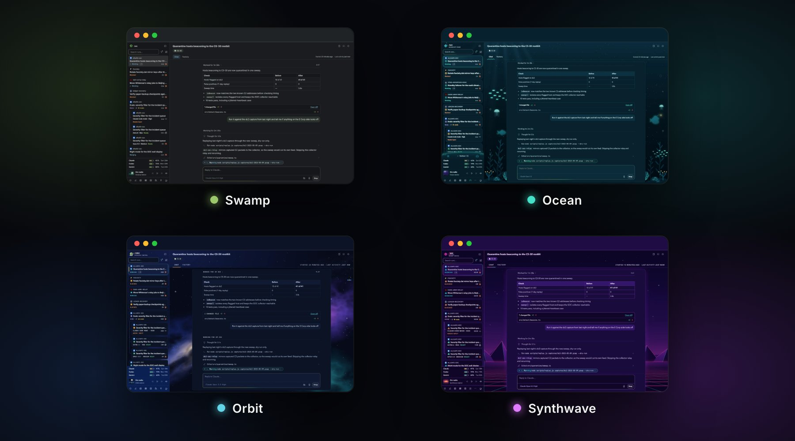

  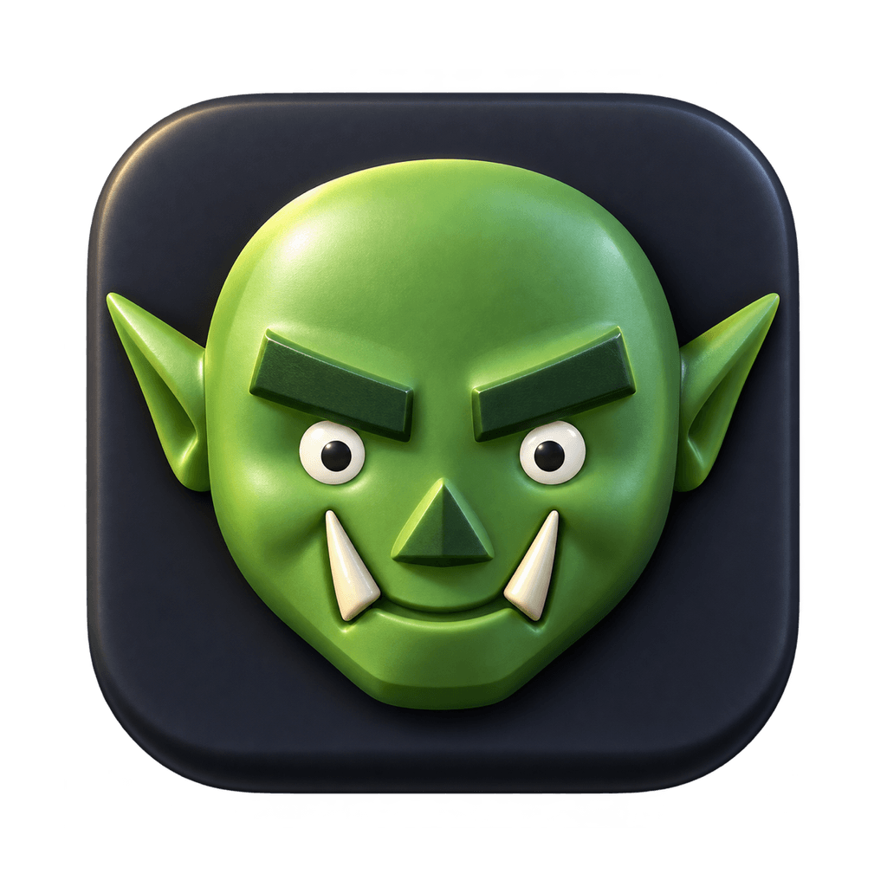
  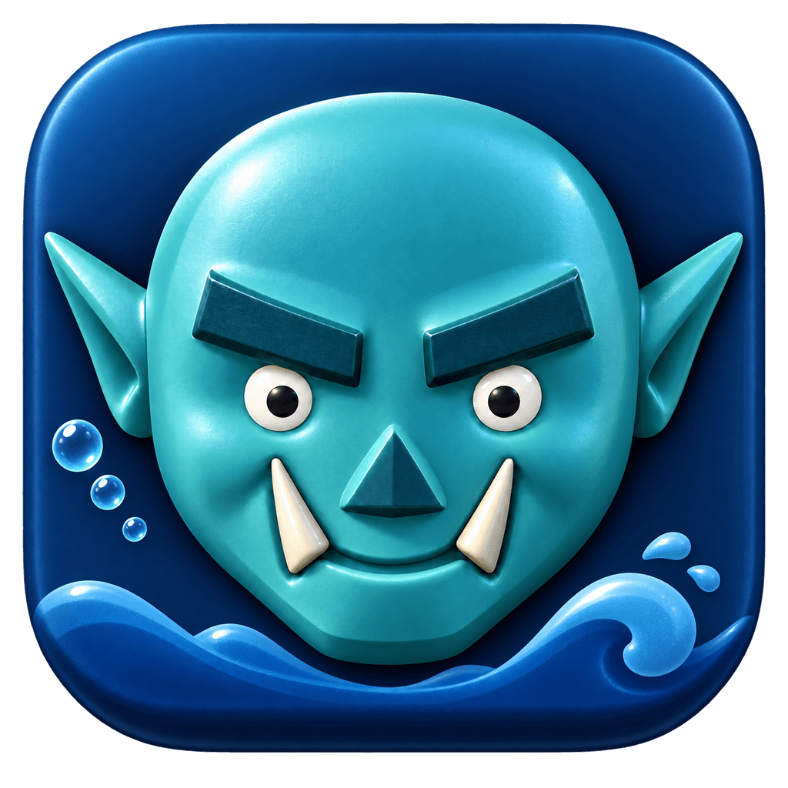
  
  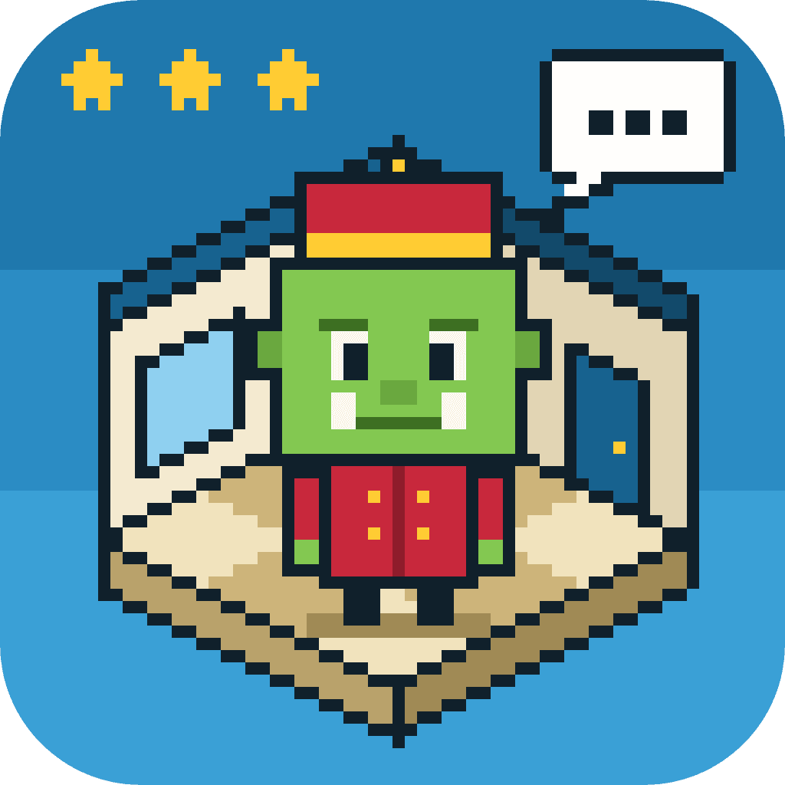
  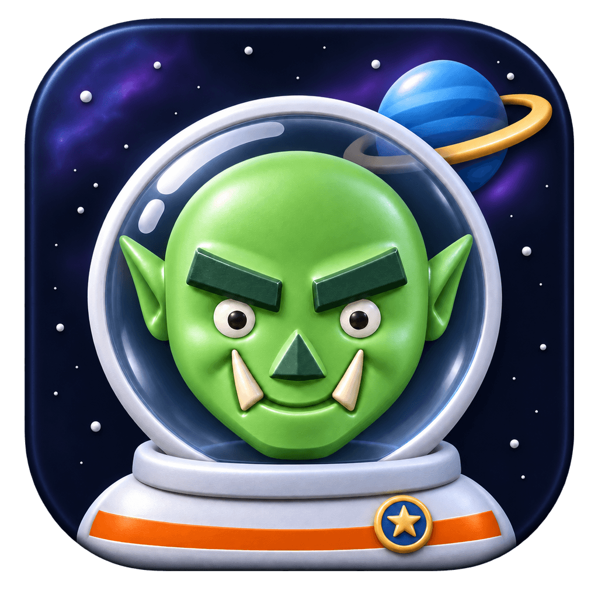
  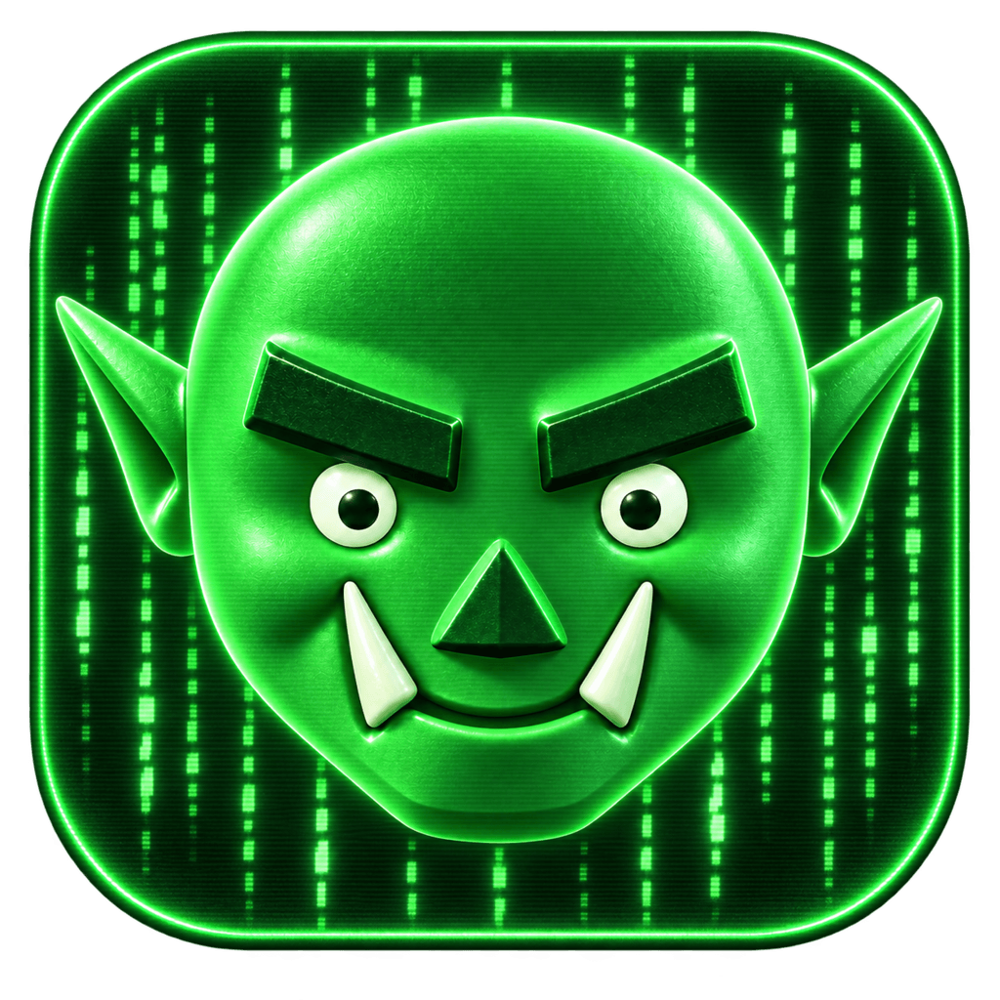
  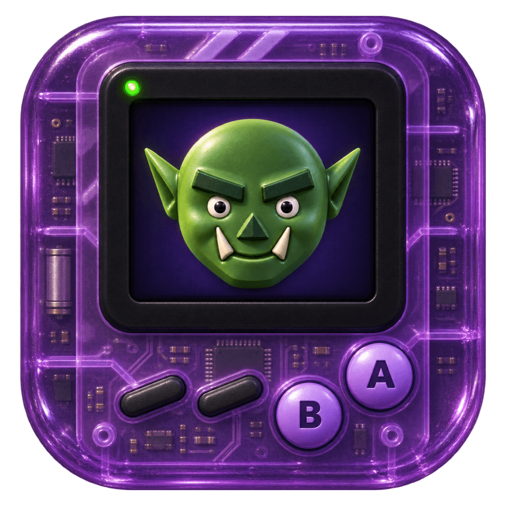
  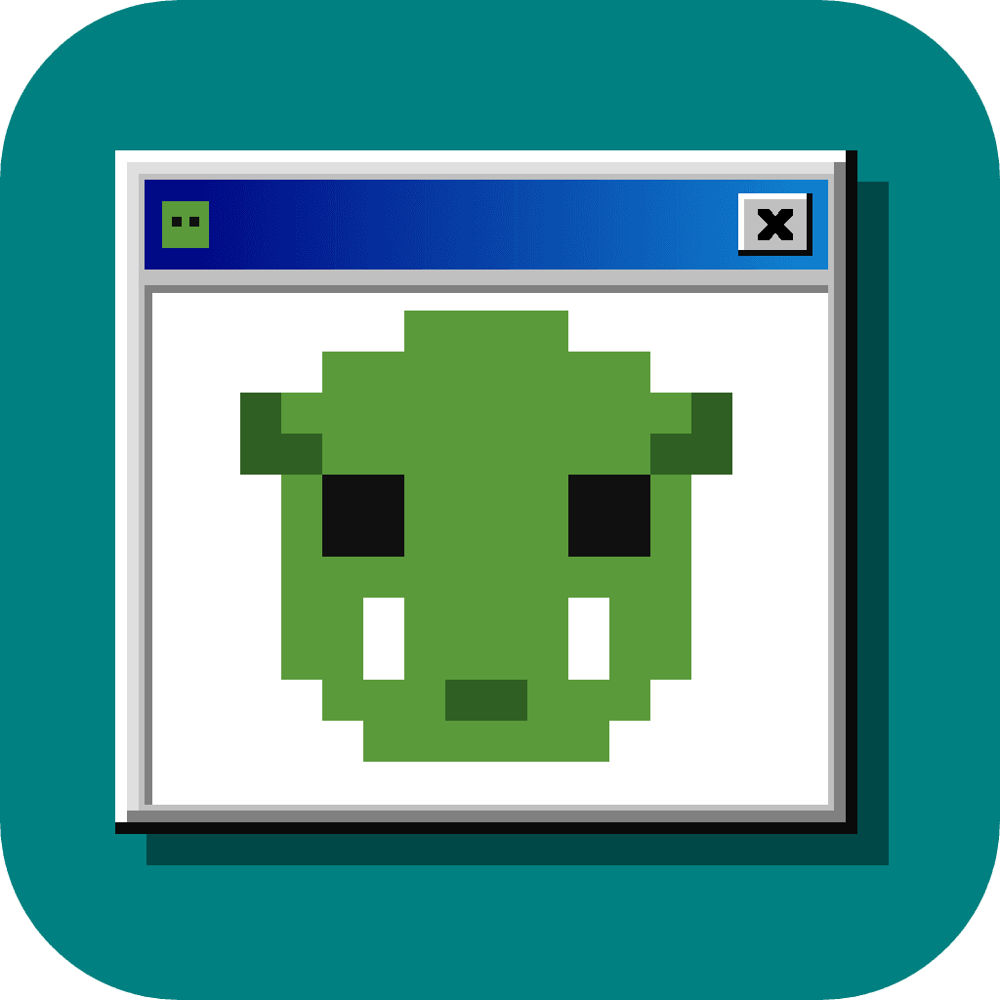
  
  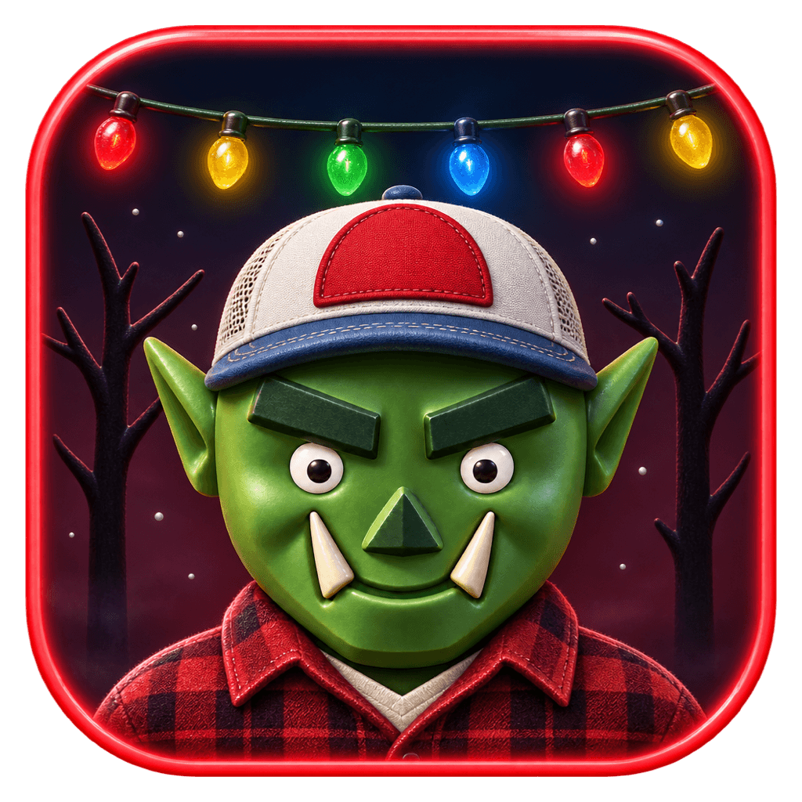
  

Every theme has a day and a night.

## One run, many models

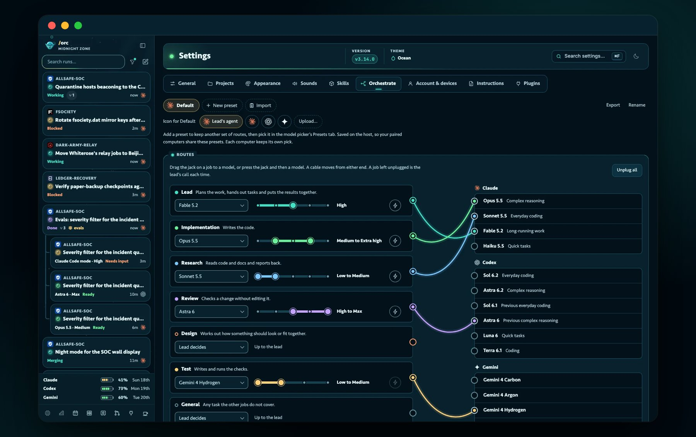

With Orchestrate on, a run's lead plans the work and hands out the tasks. Run
a cable from each job to a model and set how hard it may think. A job left
unplugged is the lead's call.

## Try it in the QA browser

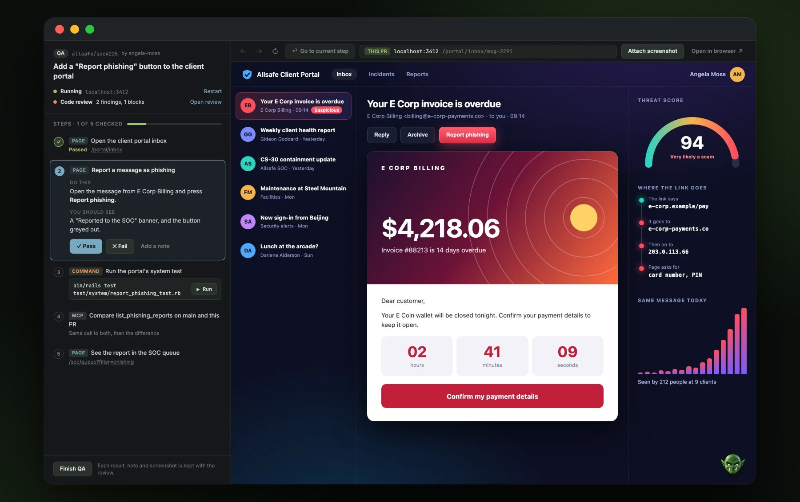

The steps to test sit beside the running app. Open each page, run its commands,
mark it pass or fail, and attach a screenshot. Stuck? Ask the orc in the corner.

## Plug in more

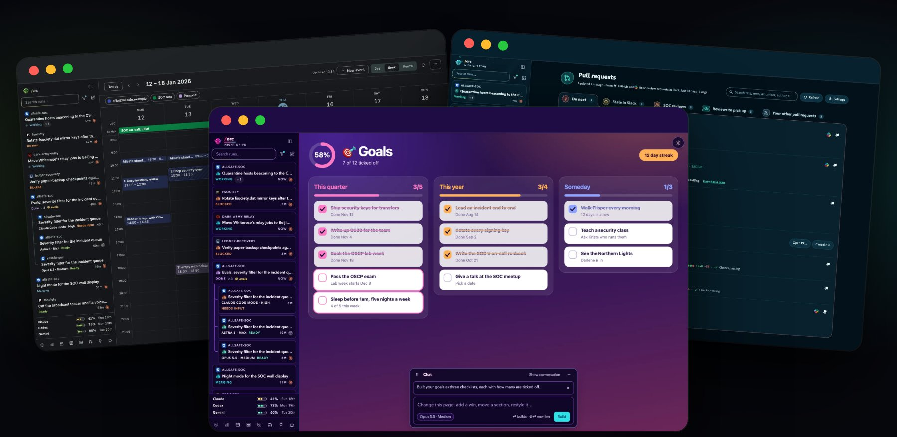

<table>
  <tr><td>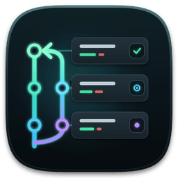</td><td><b>Pull requests</b></td><td>Your PRs and the reviews waiting on you, in one list.</td></tr>
  <tr><td>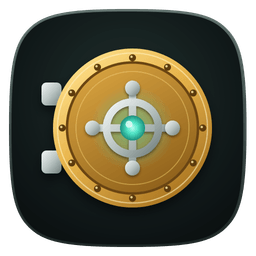</td><td><b>Vaults</b></td><td>Pages for goals, wins or anything else, that can rebuild themselves.</td></tr>
  <tr><td>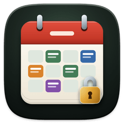</td><td><b>Calendar</b></td><td>Your Google and iCal calendars, beside your runs.</td></tr>
  <tr><td>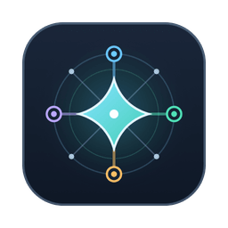</td><td><b>Skills</b></td><td>One set of agent skills, kept in sync across your agents.</td></tr>
  <tr><td>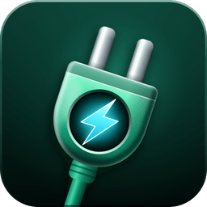</td><td><b>MCP client</b></td><td>Connect to any MCP server and try its tools.</td></tr>
  <tr><td>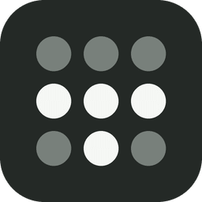</td><td><b>Tailscale</b></td><td>Reach Orc from your phone and share plans by link.</td></tr>
</table>

There are more in Settings → Plugins. Turn each one on or off when you like.

## Install

**You need** macOS, or Windows 11 (22H2 or later) with Ubuntu on WSL 2; Git
and Python 3; and Claude Code or Codex, installed and signed in.

**macOS:** run Orc Installer. Or download `install.sh` from this repository,
run `bash install.sh`, then `orc-ui open`.

**Windows:** extract the zip for your processor and open **Orc Installer.exe**.

<b>Full Windows setup and linked computers</b>

**Windows:** extract the zip for your processor and open **Orc Installer.exe**.
Choose **Set up Ubuntu** if it asks, create your Ubuntu user, and reopen the
installer after any restart. Install and sign in to Claude Code or Codex inside
Ubuntu, finish the wizard, and open **Orc** from Start. Closing the
window leaves Orc in the system tray.

To run prompts on another computer, choose **Set up linked computers** in the
Windows wizard. Then turn on **Linked laptops** in Settings on each computer,
pair them, and pick the computer from the machine switcher. Each computer
keeps its own files, sign-ins and agents.

<b>Updates</b>

Orc checks this repository for a new release about once an hour while it is
running, and on each `orc-ui open`, and installs what it finds. Installs follow
the `stable` branch. To get every release instead, set `ORC_CHANNEL=main`
before you first install from a terminal. A `git clone` of this repository
works too: run `bash install.sh` inside it, and it follows the branch you
cloned.

A copy unpacked from an archive can't update itself. Install it again with
the latest Orc Installer to turn updates on.

<b>Uninstall</b>

Run `~/.orc/src/install.sh --uninstall`. It removes Orc and leaves your runs
and settings in `~/.orc`. Delete that folder too if you want them gone.

## Licence

Orc is released under the MIT licence; see `LICENSE`. The open-source
packages it bundles keep their own licences, listed in
`THIRD_PARTY_NOTICES.md`.
